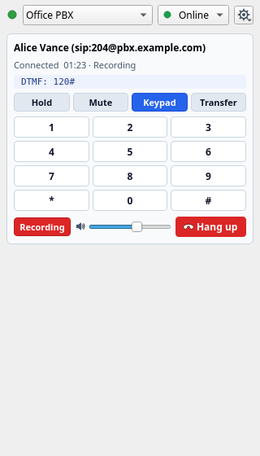
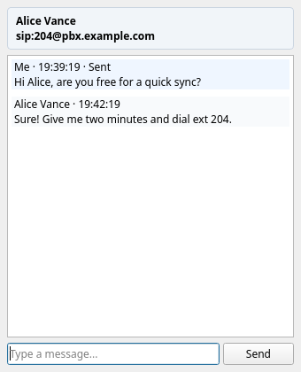
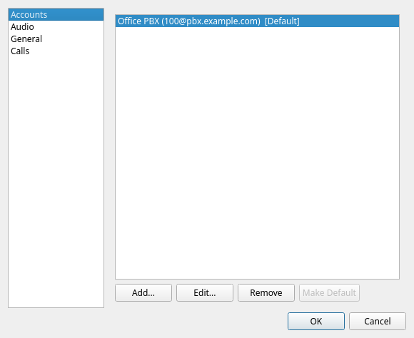
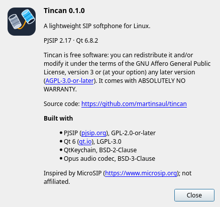

# Tincan

Tincan is a lightweight, fast SIP softphone for Linux desktops, written in
C++20 with Qt 6 Widgets and PJSIP 2.17 (`pjsua2`). It aims for a compact
window, a dial pad, quick answer and hang-up, and very little in the way.

## Status

Version **0.1.0**, the first public release. See [CHANGELOG.md](CHANGELOG.md).

## Screenshots

| Dial pad | In a call | Contacts |
|---|---|---|
|  |  |  |

| Chat | Settings | About |
|---|---|---|
|  |  |  |

The screenshots are rendered with `tincan --screenshot <dir>` using demo data.

## Features

- Several SIP accounts with one default: UDP, TCP or TLS; SRTP (off, optional
  or mandatory); STUN, ICE and public-address override; dial prefix and
  voicemail number.
- Passwords in the desktop keyring (Secret Service via QtKeychain). Without a
  keyring Tincan asks before storing a password in a private config file.
- Dial pad with paste-to-dial clean-up and redial; DTMF as RFC 4733, SIP INFO
  or in-band.
- Answer, reject, hold/resume, mute, per-call volume, blind and attended
  transfer, several simultaneous calls, local three-way conference, call
  recording to WAV.
- Incoming-call popup and desktop notifications, ringtone choice, call-waiting
  tone, auto-answer (always or on intercom headers), Do Not Disturb, local
  call forwarding.
- Contacts with presence/BLF and CSV import/export, call history with a
  missed-call badge, SIP MESSAGE chat.
- Audio device selection, echo cancellation, codec enable and order (Opus,
  G.722, G.711, GSM, Speex and more).
- System tray, start minimised, autostart, single instance, `sip:`, `sips:`,
  `tel:` and `callto:` link handler, command line (`tincan sip:200@pbx`,
  `--answer`, `--hangup`, `--show`, `--quit`); see `man tincan`.
- Translations through Qt Linguist.

## Install

Release packages are attached to each
[GitHub release](https://github.com/martinsaul/tincan/releases), together with
a `SHA256SUMS` file. Check a download with:

```sh
sha256sum --check --ignore-missing SHA256SUMS
```

### AppImage

```sh
chmod +x Tincan-0.1.0-x86_64.AppImage
./Tincan-0.1.0-x86_64.AppImage
```

The AppImage bundles Qt, QtKeychain and the other libraries Tincan needs. It
is built on Debian 13 and needs glibc 2.41 or newer. If FUSE is not available,
run it with `--appimage-extract-and-run`.

### Debian / Ubuntu package

For Debian 13 (trixie) and distributions of the same generation:

```sh
sudo apt install ./tincan_0.1.0_amd64.deb
```

### Flatpak

A manifest is in [`packaging/flatpak`](packaging/flatpak/io.github.martinsaul.Tincan.yml).
It is not published on Flathub yet; build it locally with:

```sh
flatpak-builder --user --install --force-clean build-flatpak \
  packaging/flatpak/io.github.martinsaul.Tincan.yml
```

### Build from source

Install the build dependencies (Debian 13 / trixie):

```sh
sudo apt-get install \
  build-essential cmake ninja-build pkg-config curl ca-certificates \
  qt6-base-dev qt6-tools-dev qt6-svg-dev qt6-l10n-tools \
  qtkeychain-qt6-dev libqt6sql6-sqlite \
  libsrtp2-dev libopus-dev libspeexdsp-dev \
  libpulse-dev libasound2-dev libssl-dev uuid-dev xvfb
```

Build the pinned, checksum-verified PJSIP 2.17 static libraries, then
configure, build, test and install Tincan:

```sh
tools/build-pjproject.sh
cmake -G Ninja -B build -DCMAKE_BUILD_TYPE=Release
cmake --build build
QT_QPA_PLATFORM=offscreen ctest --test-dir build --output-on-failure
sudo cmake --install build
```

Packages are built the same way: `cd build && cpack -G DEB` produces the
`.deb`, and `packaging/appimage/build-appimage.sh` produces the AppImage
(it downloads pinned, checksum-verified linuxdeploy tools into
`build/tools/`). Configure with `-DTINCAN_BUILD_TESTS=OFF` to skip the tests.

## Inspiration and credit

Tincan is inspired by [MicroSIP](https://www.microsip.org), a lightweight GPL
Windows softphone by its own authors. Tincan is an independent clean-room
implementation that contains no MicroSIP code or assets and is not affiliated
with or endorsed by the MicroSIP project.

Tincan builds upon:
- [PJSIP](https://www.pjsip.org) (`pjproject` / `pjsua2`) for SIP signalling
  and media processing.
- [Qt 6](https://www.qt.io) and
  [QtKeychain](https://github.com/frankosterfeld/qtkeychain) for the desktop
  interface, persistence and credential storage.
- [Opus](https://opus-codec.org), [libSRTP](https://github.com/cisco/libsrtp),
  OpenSSL and SQLite.

[THIRD_PARTY_NOTICES.md](THIRD_PARTY_NOTICES.md) lists every component with
its version and licence.

## Contributing

Contributions are welcome. Please read [CONTRIBUTING.md](CONTRIBUTING.md) first,
in particular the clean-room rule, and see [docs/DESIGN.md](docs/DESIGN.md) for
the architecture.

## License

Tincan is free software licensed under the GNU Affero General Public License
v3.0 or later (`AGPL-3.0-or-later`). See [LICENSE](LICENSE) for the full text.
The source code is available at https://github.com/martinsaul/tincan.
